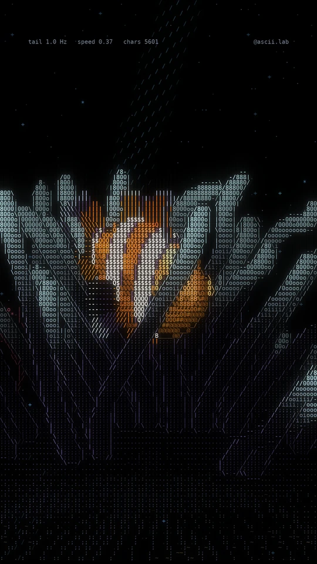

# Prompt

Procedural 3D marine ecosystem and high-performance ASCII terminal engine with undulatory clownfish kinematics and reactive Verlet sea anemone tentacles.



## Project Structure

| File | Description |
| --- | --- |
| [prompt.py](prompt.py) | Standalone procedural simulation and ASCII terminal renderer (interactive playback, PNG/MP4 export). |
| [model.html](model.html) | Interactive browser model visualizing trajectory, hydrodynamics, and kinematics over the 22-second cycle. |
| [index.html](index.html) | Web showcase and viewer. |
| [site.css](site.css) | Dark theme stylesheet for browser components. |

## Quick Start

```sh
python3 -m pip install numpy Pillow

# 1. Print a single frame to terminal:
python3 prompt.py

# 2. Live interactive real-time playback:
python3 prompt.py play

# 3. Render specific simulation timestamp:
python3 prompt.py show --time 0.8 --full
```

## Media Export

```sh
# Export single frame as PNG:
python3 prompt.py png 0.8 frame.png

# Export full 22-second video loop (requires FFmpeg):
python3 prompt.py mp4 fish.mp4

# Export short 2-second preview:
python3 prompt.py mp4 preview.mp4 --duration 2.0
```

## CLI Reference

| Command | Aliases | Description |
| --- | --- | --- |
| `show` | `terminal`, `print`, `view` | Render and print a single frame directly to terminal stdout |
| `play` | `live`, `anim` | Run live interactive animated playback directly in terminal |
| `png` | - | Export a single still frame to an image file |
| `mp4` | - | Encode and export an MP4 video loop |

### Options

- `--time <seconds>`: Simulation timestamp to evaluate (default: 0.0)
- `--no-color`: Disable ANSI 24-bit TrueColor escaping
- `--full`: Display full scene bounds without dynamic camera framing
- `-q`, `--quiet`: Suppress render status and progress meter
- `--duration <seconds>`: Video duration limit for MP4 export
- `--code`: Include bottom source code inspection panel
